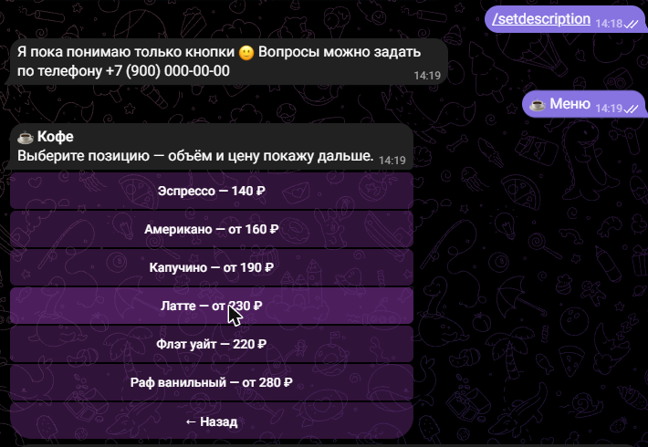
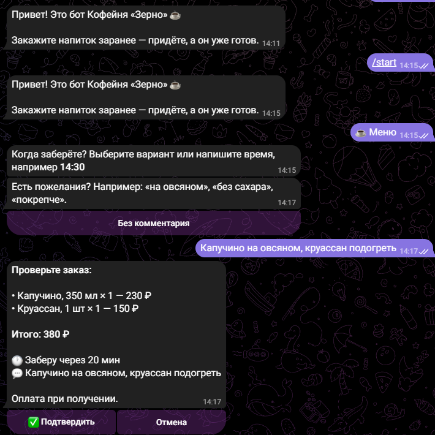
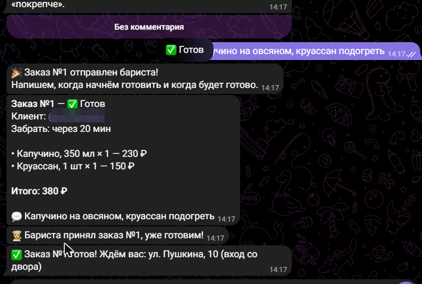

# ☕ Telegram-бот для кофейни: предзаказ + ИИ-консультант

Гость заказывает кофе заранее, а приходит к готовому. На вопросы в свободной форме отвечает нейросеть, строго по меню и информации о кофейне.

Демо: [@zerno_kofe_bot](https://t.me/zerno_kofe_bot)

| Меню | Оформление | Бариста и уведомления |
|---|---|---|
|  |  |  |

## Возможности

**Для гостей**
- Меню с категориями, описаниями, объёмами и ценами
- Корзина: добавление, подсчёт суммы, очистка
- Предзаказ: «через 10/20/30 минут» или к точному времени (14:30), пожелания к заказу («на овсяном», «без сахара»)
- Уведомления о статусе: «готовится» и «готов, ждём вас»
- ИИ-консультант (Claude) отвечает на вопросы: «есть безлактозное молоко?», «что взять не очень крепкое?», «до скольки работаете?». Отвечает только по данным кофейни и не выдумывает цены и позиции.

**Для бариста**
- Заказы приходят в отдельный чат (личку или группу) карточкой с составом, временем и комментарием
- Кнопки «Принять», «Готов», «Отменить», клиент получает уведомление автоматически
- Все заказы сохраняются в базу SQLite

**Для владельца**
- Меню, цены, адрес и FAQ лежат в одном файле `menu.json`, для правки программист не нужен
- Без ключа нейросети бот всё равно работает на кнопках

## Стек
Python 3.12 · aiogram 3 · Claude API (anthropic SDK) · SQLite (aiosqlite) · Docker

## Запуск

1. Создайте бота у [@BotFather](https://t.me/BotFather) и получите токен.
2. Скопируйте `.env.example` в `.env` и заполните `BOT_TOKEN`, `ADMIN_CHAT_ID` и, по желанию, `ANTHROPIC_API_KEY`.
3. Запустите:

**Локально**
```bash
python -m venv .venv
.venv\Scripts\activate          # Linux/macOS: source .venv/bin/activate
pip install -r requirements.txt
python -m bot
```

**На сервере через Docker**
```bash
docker compose up -d --build
```

Если заказы должны приходить в группу бариста, добавьте бота в группу и укажите её id (он начинается с `-100`) в `ADMIN_CHAT_ID`.

## Настройка
- **Меню и информация:** `menu.json`. После правки перезапустите бота (`docker compose restart`).
- **Модель ИИ:** переменная `CLAUDE_MODEL`. Для простых вопросов о меню можно поставить модель подешевле, например `claude-haiku-5-5`.

## Структура
```
bot/
  __main__.py      запуск, сборка зависимостей
  config.py        настройки из .env
  catalog.py       загрузка меню
  cart.py          корзина и карточки заказов
  db.py            заказы в SQLite
  keyboards.py     кнопки и callback-данные
  ai.py            ИИ-консультант на Claude
  handlers/
    user.py        меню, корзина, оформление, вопросы к ИИ
    admin.py       статусы заказов для бариста
menu.json          меню и FAQ кофейни
```
